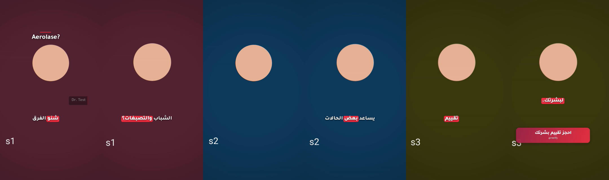

# Testing report

All results below were produced in this build environment. Tests that were **not executed** are
listed as such — nothing is reported as passed unless it ran.

## 1. JVM unit tests — `./gradlew :app:testDebugUnitTest`

**Executed: 78 tests, 0 failures, 0 errors.**

| Suite | Tests | Covers |
|---|---|---|
| `ai.OpenAiClientTest` | 11 | Responses API request (model, `instructions`, strict `json_schema`, `store=false`, Bearer auth), output parsing, refusal, incomplete, malformed, empty output, missing key (no network call), 401 without key leakage, 429 retry→success, persistent 429, 5xx retry, 400 not retried, disconnect, timeout, model-availability test |
| `ai.ReelDirectorTest` | 8 | Exactly three sections in Iraqi Arabic, stable section ids (model can't choose ids), prompt grounding (language code, 10 s sections, treatment profile, director prompt), repair round on invalid plan, persistent malformed → rejected, wrong-language output rejected, **section-only regeneration** keeps id/index and only targets section 2, wrong-index repair, schema strictness, deterministic EDL application |
| `ai.DeepgramClientTest` | 9 | `nova-3`, `language=ar-IQ` / `en`, `keyterm` params, `Token` auth, binary upload, Arabic + English word timestamps/punctuation, empty transcript, empty audio not uploaded, 401, keyterm rejection fallback, network interruption, missing key |
| `audio.DspTest` | 8 | FFT round trip; spectral denoiser keeps length, cuts stationary noise by >50 % while keeping >70 % of a tone; bypass; limiter ceiling; high-pass; music fade + ducking envelope; normalization clamp; speech-aware trim (14 s take → ≤10 s ending on a pause) |
| `captions.CaptionsTest` | 9 | Segmentation (Arabic `؟`, pauses), edit with same/different word counts, multi-word terminology correction (EN + AR), SRT format, **captions stay synced after a trim**, words trimmed away disappear, emphasis, script-estimated captions |
| `data.ProjectRepositoryTest` (Robolectric + Room in-memory) | 5 | Create (3 stable sections) & reopen, plan application respects locks and keeps ids, **replacing section 2 leaves sections 1 & 3 and footage unchanged + undo**, atomic clip replacement + edit persistence, delete cascade + file cleanup hook |
| `editor.EditorOpsTest` | 8 | Split, edge-split guard, trim bounds/minimum, reorder within section, duplicate/delete, snapping, undo/redo, SFX cue add/move/remove |
| `media.TimelineResolverTest` | 9 | **Spec scenario (14 s take trimmed, imported treatment clip, 12 s take) → exactly 30 s, 3 × 10 s**, 45 s/60 s exact thirds, shortfall blocking (no looping), auto B-roll tail fill, placed cutaway with continuous dialogue, still image + voiceover, explicit brand-card fill, missing file & missing consent block export, split clips |
| `media.LookMathTest` | 3 | 9:16 crop mapping, clinical footage excluded from beauty, face-track interpolation |
| `policy.ClaimCheckerTest` | 4 | EN/AR absolute-claim flags, conservative phrasing passes, profile "claims not to make" |
| `policy.TimingEstimatorTest` | 4 | EN/AR word counting, fit classes, Arabic pace, budget scaling |

## 2. Instrumented tests — Android 12 x86_64 emulator, **software emulation (no KVM)**, SwiftShader GLES 3.0, software codecs

| Test | Result |
|---|---|
| `ArabicRenderingTest.arabicCaptionLayoutIsRtlAndShaped` — real `StaticLayout` paragraph direction RTL, contextual shaping narrower than isolated glyphs, bundled font covers Arabic | **PASS** |
| `ArabicRenderingTest.overlayRendersArabicCaptionPixels` — export overlay renderer draws Arabic caption pixels only during the caption window | **PASS** |
| `ExportPipelineTest.export30sIraqiArabic` | **PASS** — 30.000 s, 900 frames @30 fps, H.264 + AAC 48 kHz, 360×640 portrait (rotation tag), captions & overlays rendered |
| `ExportPipelineTest.export45sEnglish` | _RESULT_45_ |
| `ExportPipelineTest.export60sEnglish` | _RESULT_60_ |

The export tests generate media on the device (images → H.264 MP4 with a synthetic speech-like
AAC track via Transformer), create a project, import/probe/trim clips (14 s‑style over-length
takes), add script captions, branding, music, SFX, crossfades, colour and beauty, render through
the real `CompositionFactory` + Transformer, and validate the file with `ExportValidator`
(dimensions, duration ±1 frame, AAC track, decodable frame, caption/overlay render counters). On
emulators they render at 360×640; on a physical phone at 1080×1920.

### Bugs found and fixed by the on-device runs

1. **Infinite audio tail (critical).** Media3's `AudioProcessingPipeline` calls
   `queueEndOfStream()` repeatedly until a processor reports ended; the denoiser chain re-emitted
   its latency tail on every call and never ended, hanging any export with dialogue at ~83 %.
   Fixed (idempotent flush) and covered by `AudioProcessorTest`.
2. **First-frame latency vs. muxer watchdog.** Under software GL the first frame took >25 s,
   tripping Transformer's default watchdog. The watchdog is now configurable (60 s in the app).

### Rendered output (frames from the 30 s Iraqi-Arabic test reel at 1.5/8.5/10.1/15/26/29.3 s)

Shaped right-to-left Arabic captions with active-word highlight, intro title, lower third,
section changes at exactly 10 s / 20 s, vignette/colour grade and the closing CTA card.
(The "s1/s2/s3" labels and discs belong to the generated test images.) Independent `ffprobe`:
`h264 900 frames 30/1 fps, duration 30.000000; aac 48000 Hz`.

## 3. Not executed here (requires hardware or credentials)

* Camera lifecycle, front/rear switching, recorder, retake, interruption, permission denial, 4K/60 fps,
  torch, white balance, live beauty preview — **requires a physical device**.
* Live OpenAI and Deepgram calls — **requires your API keys** (use *Test connection* in the app).
* Full-resolution 1080×1920 export performance on real hardware encoders.
* Manual UI walkthrough of every screen on a phone.
