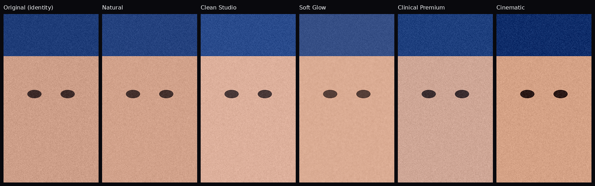
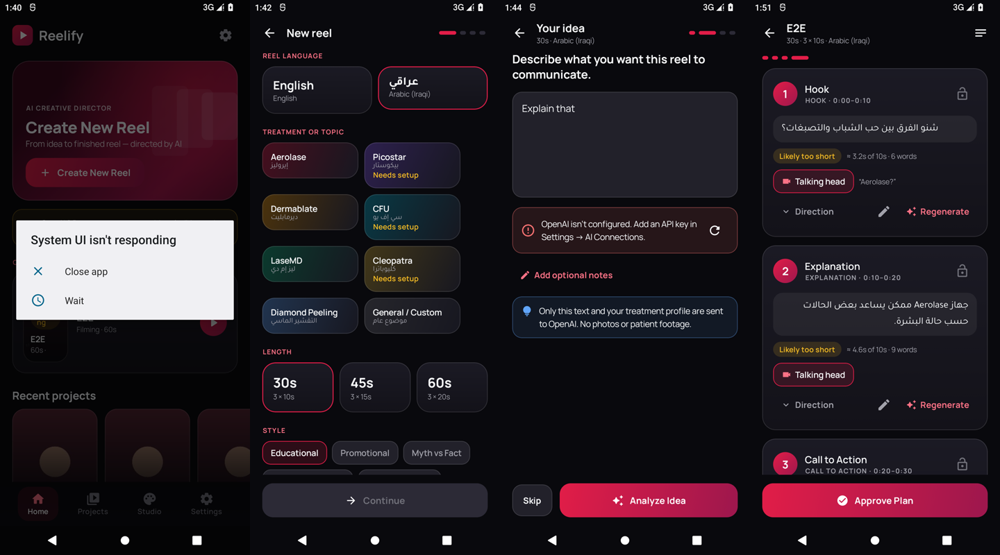

# Testing report

All results below were produced in this build environment. Tests that were **not executed** are
listed as such — nothing is reported as passed unless it ran.

## 0.1 Reelify 2.1 results (branch `reelify-2.1-stability-content`)

### JVM + Robolectric unit tests — `./gradlew :app:testDebugUnitTest`
* **Outcome**: **172 passed, 0 failed, 1 skipped** (`173` total tests across **26** test suites). Skipped case is `CreativeEvalHarness.runLiveEvaluation` (requires live `REELIFY_OPENAI_API_KEY` env var).
* **New / updated suites added in 2.1**:
  * `TrimBoundsTest` (4/4) — normal, zero-duration, `<200ms` ultra-short, inverted ranges, rapid nudge & reset invariants.
  * `PreviewAndCompositionSafetyTest` (4/4, Robolectric SDK 35) — explicit positive `durationUs != C.TIME_UNSET` across `singleClipPreview` (audio/muted/trimmed/image/voiceover) and full multi-track `CompositionFactory.build()` (beauty + B-roll + voiceover + music + SFX + captions + brand fill card), plus SHA-256 `PreviewProxyManager.fingerprint` invalidation and tmp-file safety.
  * `TemplateArtworkGeometryTest` (3/3) — normalized `[0f..1f]` containment across all `FramingPreset` talking-head and device B-roll frames.
  * `TreatmentKnowledgeAndTopicCatalogTest` (5/5) — verifies `>= 10` topics per combination across all 7 treatments × 6 templates (`420+` verified + `60` Cleopatra pending), fact reference integrity, CFU HIFU (not laser) safety, PicoStar wavelengths/handpieces, and Cleopatra vs DiamondGlow® ambiguity guard.
  * `MigrationTest` (2/2, Robolectric + Room) — adds v2.0 -> v2.1 non-destructive `LibraryRepository.seedIfNeeded()` upgrade preserving user edits and confirming Cleopatra one-tap mapping.
  * `TeleprompterPacingTest` (3/3) — short stationary viewport handling, `30/45/60s` synchronized scroll plans with lead-in hold, multiplier scaling, and reading-voice calibration.
  * `Reelify21ScenariosTest` (3/3, MockWebServer) — end-to-end PicoStar (`30s` `ar-IQ` `myth_buster`), CFU Èlife (`45s` `ar-IQ` `patient_question`), and Aerolase (`60s` `en` `expert_explains`) checks.
  * Existing suites updated for 2.1 & all passing: `DialectAndTopicsTest` (9/9), `CreativeEvalHarness.evalSetIsBalanced` (1/1 passed, `runLiveEvaluation` 1 skipped), `ScriptWriterTest` (15/15), `TemplateEngineTest` (13/13), `NormalizerCorpusTest` (15/15), `TimelineResolverTest` (9/9), `CaptionsTest` (9/9), `EditorOpsTest` (8/8), `OpenAiClientTest` (11/11), `DeepgramClientTest` (9/9), `ReelDirectorTest` (8/8), `DspTest` (8/8), `BeautyCalibrationTest` (8/8), `TemplateProjectTest` (7/7), `ProjectRepositoryTest` (5/5), `ClaimCheckerTest` (4/4), `TimingEstimatorTest` (4/4), `LookMathTest` (3/3), `AudioProcessorTest` (2/2).
* **Not executed here (requires physical device / live API keys)**: instrumented tests (`androidTest`), on-device Media3 `ExoPlayer` / `TransformerRunner` proxy generation on camera hardware, GPU beauty ShaderProgram live rendering, live `REELIFY_OPENAI_API_KEY` script quality scoring, and human Baghdad Iraqi dialect review.

## 0. Reelify 2.0 results (branch `reelify-v2-refactor`)

### JVM unit tests — `./gradlew :app:testDebugUnitTest`

**Executed: 150 tests, 0 failures** (80 from 1.x, all still passing, + 70 new). The live creative
evaluation (`CreativeEvalHarness.runLiveEvaluation`) is **skipped** without an OpenAI key.

| New suite | Tests | Covers |
|---|---|---|
| `template.TemplateEngineTest` | 13 | 6 templates × exactly 3 ordered shots, all presets resolve, templates differ in ≥3 attributes pairwise, 10/15/20 s sections, **golden structure/instruction stability (v1)**, deterministic sections with stable ids, **AI script cannot change template-owned fields (tampered input)**, locks + one-shot regeneration preserve other shots, template edit defaults, deterministic SFX positions, **user overrides win + idempotent re-application**, override bookkeeping, camera presets (front+teleprompter+beauty vs rear B-roll without either) + per-shot overrides, legacy sections untouched |
| `data.TemplateProjectTest` (Robolectric + Room) | 7 | Template snapshot stored, applyScript writes only script fields + revisions + one-shot rewrite + undo, user edits → overrides, reset to template, **custom template v2 does not change a project made with v1**, legacy projects stay LEGACY, duplicate keeps template/script, topic history |
| `data.MigrationTest` (Robolectric) | 1 | Builds a **real schema-v1 database from `schemas/…/1.json`**, fills it like 1.0 (project with concept/plan/edit/captions, 3 sections incl. locked, a revision, a clip with trims, custom treatment, terminology), opens it with v2 + `MIGRATION_1_2` (Room validates the schema): everything preserved, mode LEGACY, new tables usable, undo still works |
| `content.NormalizerCorpusTest` | 15 | English, Iraqi Arabic, mixed treatment names with Arabic prefixes, Arabic-Indic digits, Arabic punctuation spacing, quotes, ZWJ/ZWNJ/RLM kept, RLO/ZWSP/BOM removed, balanced vs unbalanced bidi controls, harakat + NFC, markdown, escaped newlines/unicode, emoji (ZWJ, VS16, skin tone), U+FFFD + controls, presentation forms → letters (ﷺ kept), **mojibake repair**, whitespace, 60-sentence dialogue unchanged, display filter, dominant-script direction |
| `content.DialectAndTopicsTest` | 9 | MSA flagged / Iraqi not, prefixed markers (وسوف), ≥20 curated examples all UNREVIEWED and none "formal", owner approvals rank first & rejections excluded, overused phrases, needs-configuration profiles get only generic topics, indication filtering, recent-history ordering, localized titles |
| `ai.ScriptWriterTest` (MockWebServer) | 15 | Script-only output with hook leading shot 1, strict json_schema, **dedicated Iraqi system prompt with reference lines**, recent hooks in context, schema cannot express camera/framing/lighting/transition/music/SFX/shot type/media plan, English prompt, **formal MSA → repair round**, near-duplicate & same-style hooks rejected, too-long shot + unsafe claim → errors (myth shot → note), terminology spelling + markdown cleaned, one-shot rewrite returns only that shot, wrong-section rewrite repaired, locked shots never sent, new hooks must differ, fresh ideas validated, hook swap, missing key → no request |
| `beauty.BeautyCalibrationTest` | 8 | Every preset non-identity at default intensity, presets pairwise distinct (parameter distance ≥ 0.6), intensity monotonic & 0 = identity, clinical → identity, glow/split uniforms present in both shader variants, **upright→sensor-buffer mapping for 0/90/180/270°**, front-camera face (rotation 270) lands at the correct texture position (and not where 1.x put it), up vectors |
| `eval.CreativeEvalHarness` | 1 (+1 skipped) | 30 balanced scenarios (all treatments, all templates, 3 durations, 17 AR / 13 EN) |

### Instrumented tests — Android 12 x86_64 emulator, software emulation (no KVM), SwiftShader GL

| Test | Result |
|---|---|
| `BeautyShaderGpuTest.beautyPresetsChangePixelsMeasurablyAndDistinctly` — synthetic skin card rendered through the **real** beauty shader on the device GPU stack | **PASS** (numbers below) |
| `CameraOverlayLayoutTest.overlayRegionsNeverOverlap` — top bar / teleprompter / chips / bottom controls at 7 screen sizes (320×568 … 840×600 dp) × font scale 1.0/1.3/2.0 × 3 teleprompter positions, long Arabic text | **PASS** (63 configurations, no overlap) |
| `ArabicRenderingTest` (3) — RTL shaping, caption pixels, **Arabic line starting with “Aerolase” is RTL with the 2.0 heuristic (1.x heuristic shown LTR)** | **PASS** |
| **On-device upgrade 1.x → 2.0** — `adb install -r` of the 2.0 APK over the 1.x app holding real data (8 projects, 24 sections, 18 clips) | **PASS**: `user_version` 1 → 2; projects, sections, clips, revisions, treatments and terminology **byte-identical** in all original columns; all projects `LEGACY`; new tables created; Home lists the old projects |

Beauty shader measurements (mean absolute pixel change vs. identity, 0–255; texture = mean
|pixel − 4-neighbour mean| on the skin area; intensity 0.7):

| Preset | Pixel change | Skin texture reduction | Background texture change |
|---|---|---|---|
| Natural | 4.19 | −21 % | +14 % (sharpen) |
| Clean Studio | 16.85 | −25 % | +34 % |
| Soft Glow | 14.26 | −53 % | −16 % |
| Clinical Premium | 6.89 | −3 % | +53 % (clarity/sharpen) |
| Cinematic | 7.35 | −15 % | +48 % |

Pairwise preset differences: 5.7–18.5 (all ≥ 1.5 threshold). Natural intensity 0.3 → 1.84,
1.0 → 5.94. Smoothing is skin-selective (skin texture always reduced more than the background).

This proves parameters reach the GPU and presets are distinct and measurable. It does **not** prove
the look is flattering on real faces or that the live camera preview matches on your phone — that
requires the hardware check in section 3.

---

# Reelify 1.x testing report (kept for reference)

## 1. JVM unit tests — `./gradlew :app:testDebugUnitTest`

**Executed: 80 tests, 0 failures, 0 errors.** (78 + 2 audio-processor regression tests added after the on-device bug below.)

| Suite | Tests | Covers |
|---|---|---|
| `ai.OpenAiClientTest` | 11 | Responses API request (model, `instructions`, strict `json_schema`, `store=false`, Bearer auth), output parsing, refusal, incomplete, malformed, empty output, missing key (no network call), 401 without key leakage, 429 retry→success, persistent 429, 5xx retry, 400 not retried, disconnect, timeout, model-availability test |
| `ai.ReelDirectorTest` | 8 | Exactly three sections in Iraqi Arabic, stable section ids (model can't choose ids), prompt grounding (language code, 10 s sections, treatment profile, director prompt), repair round on invalid plan, persistent malformed → rejected, wrong-language output rejected, **section-only regeneration** keeps id/index and only targets section 2, wrong-index repair, schema strictness, deterministic EDL application |
| `ai.DeepgramClientTest` | 9 | `nova-3`, `language=ar-IQ` / `en`, `keyterm` params, `Token` auth, binary upload, Arabic + English word timestamps/punctuation, empty transcript, empty audio not uploaded, 401, keyterm rejection fallback, network interruption, missing key |
| `audio.AudioProcessorTest` | 2 | Voice chain / gain / limiter processors keep exact length and terminate under repeated `queueEndOfStream()` (regression) |
| `audio.DspTest` | 8 | FFT round trip; spectral denoiser keeps length, cuts stationary noise by >50 % while keeping >70 % of a tone; bypass; limiter ceiling; high-pass; music fade + ducking envelope; normalization clamp; speech-aware trim (14 s take → ≤10 s ending on a pause) |
| `captions.CaptionsTest` | 9 | Segmentation (Arabic `؟`, pauses), edit with same/different word counts, multi-word terminology correction (EN + AR), SRT format, **captions stay synced after a trim**, words trimmed away disappear, emphasis, script-estimated captions |
| `data.ProjectRepositoryTest` (Robolectric + Room in-memory) | 5 | Create (3 stable sections) & reopen, plan application respects locks and keeps ids, **replacing section 2 leaves sections 1 & 3 and footage unchanged + undo**, atomic clip replacement + edit persistence, delete cascade + file cleanup hook |
| `editor.EditorOpsTest` | 8 | Split, edge-split guard, trim bounds/minimum, reorder within section, duplicate/delete, snapping, undo/redo, SFX cue add/move/remove |
| `media.TimelineResolverTest` | 9 | **Spec scenario (14 s take trimmed, imported treatment clip, 12 s take) → exactly 30 s, 3 × 10 s**, 45 s/60 s exact thirds, shortfall blocking (no looping), auto B-roll tail fill, placed cutaway with continuous dialogue, still image + voiceover, explicit brand-card fill, missing file & missing consent block export, split clips |
| `media.LookMathTest` | 3 | 9:16 crop mapping, clinical footage excluded from beauty, face-track interpolation |
| `policy.ClaimCheckerTest` | 4 | EN/AR absolute-claim flags, conservative phrasing passes, profile "claims not to make" |
| `policy.TimingEstimatorTest` | 4 | EN/AR word counting, fit classes, Arabic pace, budget scaling |

## 2. Instrumented tests — Android 12 x86_64 emulator, **software emulation (no KVM)**, SwiftShader GLES 3.0, software codecs

| Test | Result |
|---|---|
| `ArabicRenderingTest.arabicCaptionLayoutIsRtlAndShaped` — real `StaticLayout` paragraph direction RTL, contextual shaping narrower than isolated glyphs, bundled font covers Arabic | **PASS** |
| `ArabicRenderingTest.overlayRendersArabicCaptionPixels` — export overlay renderer draws Arabic caption pixels only during the caption window | **PASS** |
| `ExportPipelineTest.export30sIraqiArabic` | **PASS** — 30.000 s, 900 frames @30 fps, H.264 + AAC 48 kHz, 360×640 portrait (rotation tag), captions & overlays rendered |
| `ExportPipelineTest.export45sEnglish` | **PASS** — 45.000 s, 1350 frames, H.264 + AAC |
| `ExportPipelineTest.export60sEnglish` | **PASS** — 60.000 s, 1800 frames, H.264 + AAC |

The export tests generate media on the device (images → H.264 MP4 with a synthetic speech-like
AAC track via Transformer), create a project, import/probe/trim clips (14 s‑style over-length
takes), add script captions, branding, music, SFX, crossfades, colour and beauty, render through
the real `CompositionFactory` + Transformer, and validate the file with `ExportValidator`
(dimensions, duration ±1 frame, AAC track, decodable frame, caption/overlay render counters). On
emulators they render at 360×640; on a physical phone at 1080×1920.

### Bugs found and fixed by the on-device runs

1. **Infinite audio tail (critical).** Media3's `AudioProcessingPipeline` calls
   `queueEndOfStream()` repeatedly until a processor reports ended; the denoiser chain re-emitted
   its latency tail on every call and never ended, hanging any export with dialogue at ~83 %.
   Fixed (idempotent flush) and covered by `AudioProcessorTest`.
2. **First-frame latency vs. muxer watchdog.** Under software GL the first frame took >25 s,
   tripping Transformer's default watchdog. The watchdog is now configurable (60 s in the app).

### Rendered output (frames from the 30 s Iraqi-Arabic test reel at 1.5/8.5/10.1/15/26/29.3 s)

Shaped right-to-left Arabic captions with active-word highlight, intro title, lower third,
section changes at exactly 10 s / 20 s, vignette/colour grade and the closing CTA card.
(The "s1/s2/s3" labels and discs belong to the generated test images.) Independent `ffprobe`:
`h264 900 frames 30/1 fps, duration 30.000000; aac 48000 Hz`.

### UI smoke check on the emulator (manual, via adb)

Home → New Reel setup → Idea → Analyze (no key: clear, retryable "OpenAI isn't configured" error,
no stuck spinner) → Projects → Arabic script screen (RTL, shaped, timing-fit badges). No Reelify
crashes were logged. (A SystemUI ANR dialog visible on Home belongs to the emulator, which was
recovering from a `system_server` restart caused by emulation slowness.)

Found during this check: rapid text entry could drop characters because the field's value
round-tripped through a ViewModel `StateFlow`; `ReelTextField` now keeps local edit state. (Under
the TCG emulator, adb key injection itself still reorders/drops keys, so this was confirmed only as
far as the emulator allows.)

## 3. Not executed here (requires hardware or credentials)

* Camera lifecycle, front/rear switching, recorder, retake, interruption, permission denial, 4K/60 fps,
  torch, white balance, live beauty preview — **requires a physical device**.
* Live OpenAI and Deepgram calls — **requires your API keys** (use *Test connection* in the app).
* Full-resolution 1080×1920 export performance on real hardware encoders.
* Manual UI walkthrough of every screen on a phone.
